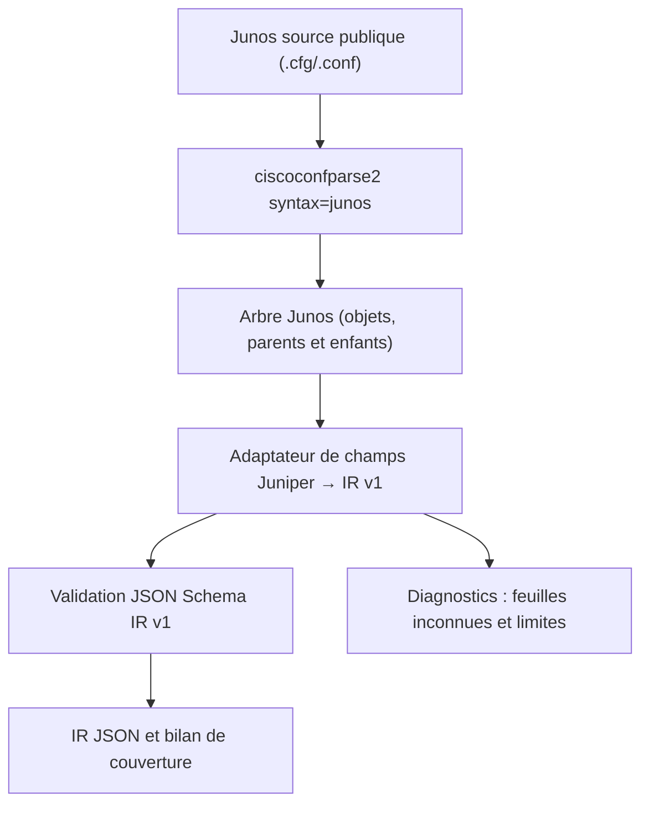

# 6NLG — Adaptateur Juniper Junos vers l'IR réseau v1 existante

## Objectif

**Réutiliser la normalisation Cisco v1 sans modifier ni le parseur Cisco ni son schéma**.
On utilise exclusivement la bibliothèque tierce `ciscoconfparse2` pour construire
l'arbre de configuration hiérarchique Junos, puis le module
`normalizers/juniper_ir_adapter.py` projette les objets reconnus vers les champs
IR v1. Il ne contient **aucun nouveau parseur grammatical Junos**.

Chaque résultat est validé contre le **schéma déjà présent**
`schemas/network_device_ir_v1.schema.json` grâce à `jsonschema`.

## Installation dans VOTRE projet existant (WSL)

Décompresser l'archive à la **racine** de votre projet :

```bash
cd ~/projet-6nlg/network-config-audit
unzip -n /mnt/c/Users/LENOVO/Downloads/6NLG_Juniper_CiscoConfParse2_IR_V1.zip -d .
source .venv/bin/activate
python3 -m pip install -r requirements-juniper.txt
```

`unzip -n` n'écrase pas les scripts Cisco existants. Il ajoute uniquement :

```text
normalizers/juniper_ir_adapter.py
scripts/evaluate_juniper_ir.py
tests/test_juniper_ir_adapter.py
requirements-juniper.txt
README_ADAPTATEUR_JUNIPER_IR_V1.md
reports/validation_batfish_six.json
reports/validation_junosphere_srx.json
reports/NOTE_VALIDATION_JUNIPER.md
reports/examples_batfish_ir/*.ir.json
reports/examples_junosphere_ir/*.ir.json
```

Les deux premiers jeux de données **restent dans leurs dépôts sources**,
ils ne sont pas recopiés dans cette livraison.

### 1. Valider les six fichiers EVPN de Batfish

```bash
cd ~/projet-6nlg/network-config-audit
source .venv/bin/activate
python3 scripts/evaluate_juniper_ir.py \
  ../juniper_sources/batfish-lab-validation/snapshots/junos_evpn_type5/source/configs \
  --schema schemas/network_device_ir_v1.schema.json \
  --output-dir reports/juniper_ir/batfish \
  --json-summary reports/validation_batfish_six.json \
  --strict-schema
```

### 2. Valider le corpus indépendant Junosphere et identifier la limite SRX

```bash
python3 scripts/evaluate_juniper_ir.py \
  ../juniper_sources/junosphere \
  --schema schemas/network_device_ir_v1.schema.json \
  --output-dir reports/juniper_ir/junosphere \
  --json-summary reports/validation_junosphere_srx.json \
  --srx-markdown ../juniper_sources/juniper-srx-config/srx110h-va/config.md
```

Les 3 fichiers `CTS0.conf` du dépôt Junosphere sont vides : état
`skipped_empty`, **ils ne constituent pas des échecs du parseur**.
La source SRX est un tutoriel Markdown contenant des commandes `set` : le résultat
`unsupported_format` est attendu et signale une **limite réelle de ce parcours**.
La commande n'utilise pas `--strict-schema` dans ce second lot car la source
SRX non supportée provoquerait volontairement un code de sortie non nul.

### 3. Tests automatisés avec vrais corpus publics

```bash
python3 -m unittest discover -s tests -p 'test_juniper_ir_adapter.py' -v
```

Les tests vérifient notamment : les six configurations réelles, la validation
JSON Schema, la préservation de deux ASN locaux BGP distincts, une route
`discard`, une route `next-hop`, une adresse IP, 18 configurations Junosphere,
une aire OSPF Junos, l'absence d'état opérationnel inventé et le refus explicite
du `display set` SRX.

## Architecture



## Correspondance avec l'IR existante

| Élément Junos | Champ IR v1 | Remarque |
|---|---|---|
| `version` | `device.platform.version` | Version telle qu'écrite dans le fichier |
| `system host-name` | `device.hostname` | `null` si absent |
| `interfaces <port> unit <n> family inet address` | `interfaces[].ipv4_addresses` | Noms logiques `ge-0/0/1.0` |
| `interfaces ... disable` | `interfaces[].admin_enabled = false` | Absence de `disable` → `null`, jamais `true` déduit |
| `routing-instances` | `vrfs[]` | Le type d'instance Junos est conservé ; `mgmt_junos` n'est pas déclarée VRF |
| `routing-options static route` | `routing.static_routes[]` | IPv4 ; `discard`, `reject`, `next-hop` reconnus |
| `protocols bgp group` | `routing.bgp[]` | Une entrée **par groupe** ; local-AS spécifique au groupe |
| `protocols ospf area ... interface` | `routing.ospf[]` | Aires/interfaces en extension ; `process_id` Cisco non applicable |
| `vlans ... vlan-id / vxlan vni` | `services.vlans[]` | Les VNI sont une extension légère spécifique Junos |
| `policy-options` | Diagnostic de couverture | Les règles détaillées ne sont PAS prétendues équivalentes aux route-maps Cisco |
| `protocols evpn`, `protocols lldp`, MPLS, LDP, RSVP, ISIS | Diagnostic de couverture | Pas de section dédiée dans l'IR v1 |
| Adresses IPv6 | Diagnostic de couverture | Le schéma v1 modélise seulement `ipv4_addresses` |
| Junos SRX en `set ...` | Refus de format | Nécessite une bibliothèque prenant en charge `display set` ou export hiérarchique |

## Garanties et limites

1. **Syntaxe prise en charge :** Junos hiérarchique à accolades. Aucun `set ...`
   à plat n'est silencieusement déclaré valide.
2. **Confidentialité :** rapports sans commandes brutes, mots de passe, texte libre
   d'interface ou secrets. Références de source `line=null` par prudence : la
   bibliothèque réindexe les lignes après élimination des accolades.
3. **Pas d'état réel :** `operational_state=null` ; aucune session BGP, EVPN ou
   adjacence OSPF n'est déclarée établie.
4. **Mesure de couverture :** `normalized_leaves / config_leaves` est une mesure
   *syntaxique de feuilles reconnues*, **pas** une exactitude sémantique
   vérifiée. Les fichiers Junos apparaissent `partial` même avec JSON Schema OK.
5. **OSPF Junos :** un identifiant de processus Cisco n'existe pas : l'adaptateur
   emploie `process_id=""` (chaîne vide) et documente
   `process_id_applicability="not_applicable_junos"`. Un IR v2 devrait rendre
   ce champ facultatif.
6. **Dépendance externe :** `ciscoconfparse2` est sous GPLv3 ; vérifier les
   obligations de licence avant distribution de la solution.

## À faire avant de conclure à une interopérabilité complète

- Faire relire un échantillon de champs Junos/IR par un expert réseau et
  établir une vérité terrain indépendante (golden reference), pas seulement
  la conformité JSON Schema.
- Étendre l'IR v2 pour EVPN, LLDP, MPLS, ISIS/LDP/RSVP, IPv6, les stratégies
  de filtrage Junos, le modèle de groupes BGP et les objets `routing-instances`.
- Sur SRX, obtenir un `show configuration` hiérarchique provenant d'un équipement
  ou adopter un parseur tiers qualifié pour `display set`. Tester ensuite les
  zones de sécurité, les politiques, NAT et interfaces spécifiques SRX.
- Exécuter les tests sur des fichiers supplémentaires **jamais utilisés pour
  adapter le code**, en enregistrant les fichiers exacts et les hashes SHA256.

## Sources

- Batfish lab-validation : https://github.com/batfish/lab-validation
- Junosphere : https://github.com/02strich/junosphere
- Juniper SRX : https://github.com/flightlesstux/juniper-srx-config
- ciscoconfparse2 : https://www.pennington.net/py/ciscoconfparse2/

## Inventaire détaillé des commandes non adaptées (extension v1.1)

Le script `inventory_juniper_gaps.py` réutilise le **même adaptateur** et
ses compteurs de feuilles ; il ne crée pas de deuxième parseur ni de règles
de couverture divergentes. Les catégories exportées sont limitées à des
mots-clés autorisés, sans valeurs brutes ni noms des objets métiers.

```bash
python3 scripts/inventory_juniper_gaps.py \
  ../juniper_sources/batfish-lab-validation/snapshots/junos_evpn_type5/source/configs \
  ../juniper_sources/junosphere \
  --json-summary reports/inventory_policy_protocols.json
```

Il regroupe les **303 feuilles `policy-options`** et les **217 feuilles
`protocols`** déjà identifiées. Voir `reports/inventory_policy_protocols.json`
pour le détail exact par famille de commandes.
